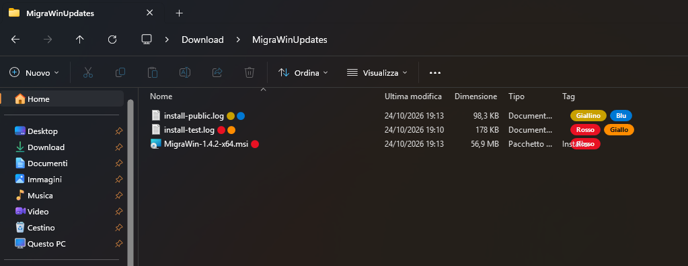
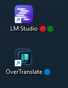
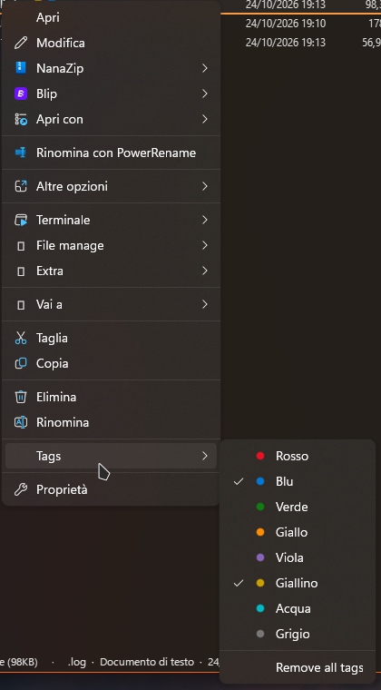

# Explorer Color Tags

A [Windhawk](https://windhawk.net/) mod that brings macOS Finder-like colored tags to Windows File Explorer and the Windows Desktop.

*Colored dots appear directly beside item names; matching colored pills appear in the Details view Tags column.*

| Desktop Icons with Tag Dots | Classic Context Menu Integration |
| :---: | :---: |
|  |  |

## Features

- **Keyboard Shortcuts**: Press `Alt+1` through `Alt+8` to quickly toggle one of 8 colored tags on selected files or folders. Press `Alt+0` to remove all tags.
- **Dots Beside File Names**: Up to three colored dots appear directly after the item name in File Explorer.
- **Desktop Support**: Tag dots are seamlessly rendered next to icons on the Windows Desktop (`SysListView32`), with intelligent redraw tracking that prevents graphical ghosting when long file names expand on hover.
- **Native Details Column**: A dedicated **Tags** column in Details view displays clean, rounded, colored pill badges for tagged items.
- **Automatic or Manual Column**: Choose whether the Tags column is automatically added to all folders in Details view or manually toggled via the header context menu.
- **Configurable Dot Sizes**: Independently configure the dot diameter for File Explorer (`explorerDotSize`) and the Desktop (`desktopDotSize`).
- **Classic Context Menu**: Right-click any file or selection to assign or remove tags from the classic context menu.
- **Zero File Rewriting**: Tags are stored in an internal index. File contents and timestamps are never modified, and native `System.Keywords` metadata is not overwritten.
- **Universal Format Support**: Works across all file types (ZIP, EXE, documents, media, extensionless files, and directories).

## Default Shortcuts & Tags

| Shortcut | Tag Name | Default Color |
| :--- | :--- | :--- |
| `Alt+1` | Important | `#E81123` (Red) |
| `Alt+2` | Work | `#0078D4` (Blue) |
| `Alt+3` | Personal | `#107C10` (Green) |
| `Alt+4` | Later | `#FF8C00` (Orange) |
| `Alt+5` | Archive | `#8764B8` (Purple) |
| `Alt+6` | Review | `#C8A000` (Yellow) |
| `Alt+7` | Home | `#00B7C3` (Teal) |
| `Alt+8` | Temporary | `#767676` (Gray) |
| `Alt+0` | Remove All Tags | — |

*All tag names and colors are fully customizable in the mod settings.*

## How It Interfaces With The System

Explorer Color Tags is designed to be lightweight, performant, and completely non-destructive:

1. **DirectUI Painting (`DUI70.dll`)**:
   Hooks `Element::PaintBackground` in DirectUI to draw the dots next to file names and render the colored pill badges in the native Details view column without interfering with Explorer's item layout or selection highlights.
2. **Desktop Integration (`SysListView32`)**:
   Subclasses the desktop list view to render tag dots next to desktop items. It dynamically tracks previous dot bounding boxes and invalidates them upon hover expansion/collapse, eliminating background ghosting and visual artifacts.
3. **Shortcut Processing (`DispatchMessageW`)**:
   Hooks `DispatchMessageW` independently to intercept `Alt+0` through `Alt+8` key presses only when an Explorer folder view or Desktop window is focused. It verifies that no active `Edit` control has focus (ensuring text editing, searching, and Alt-code input remain unaffected).
4. **Column Management (`CDefView`)**:
   Uses `IColumnManager` to manage the native `System.Keywords` column in Details view when `autoAddTagColumn` is enabled. Explorer preserves view settings per folder in view state (Bags).
5. **Context Menu (`TrackPopupMenu` / `TrackPopupMenuEx`)**:
   Dynamically appends the "Tags" submenu with color-coded dot bitmaps to the classic Explorer context menu.
6. **Isolated Internal Storage**:
   Maintains a tab-separated database (`tags.tsv`) inside Windhawk's sandboxed per-user application data directory (`%APPDATA%\Windhawk\...\Tags`). File synchronization is processed asynchronously on a background worker thread to ensure the Explorer UI thread never stalls.
7. **Clean Mod Coexistence**:
   Uses unique IPC messages (`WhExplorerColorTags_*`) and a distinct database mutex (`WindhawkExplorerColorTagsDb-<SID>`). It registers no conflicting window classes, allowing it to run cleanly alongside other Explorer mods.

## Requirements

- **Windows 11** (x86-64) or **Windows 10** (x86-64).
- **Windhawk** v1.7.3 or newer.
- Classic File Explorer context menu for the right-click submenu.

## License

This project is licensed under the [MIT License](LICENSE).
Attribution: Based on [Explorer Tags](https://github.com/buedgik/explorer-tags) by `buedgik`.
